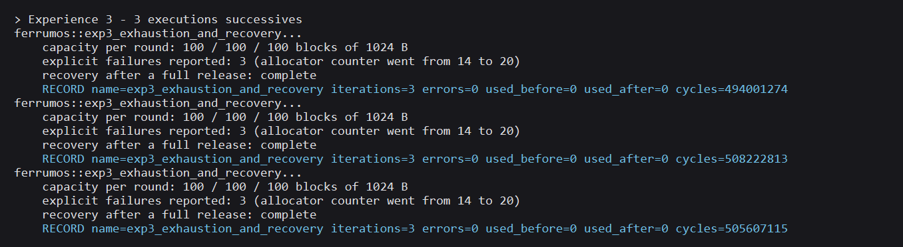
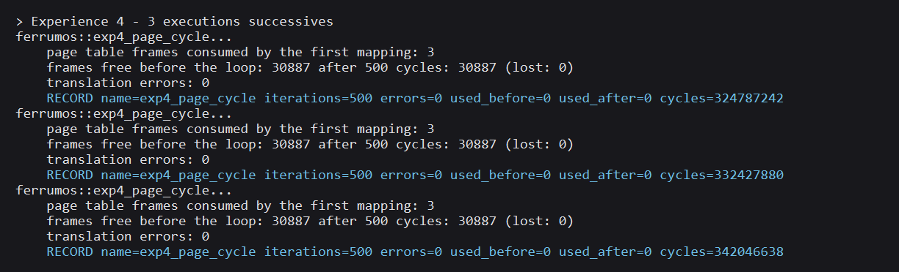
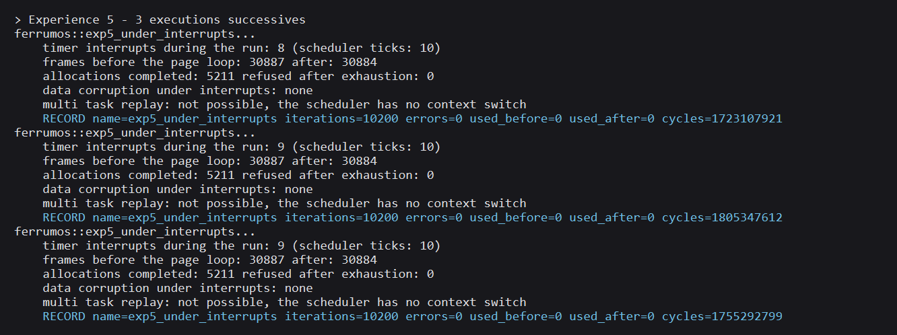
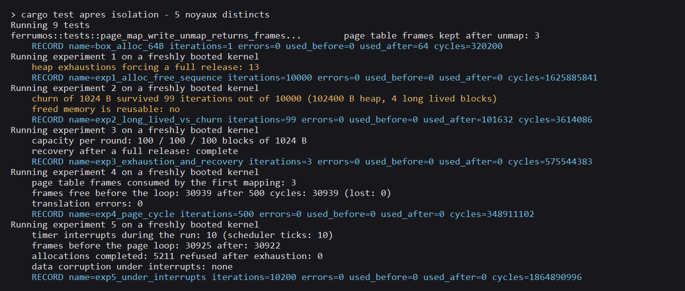
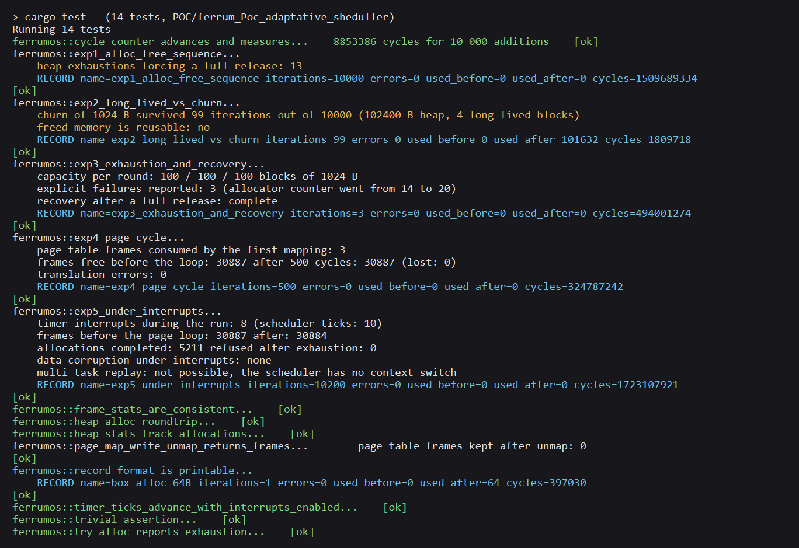

# Compte rendu des expériences 3, 4 et 5 sur l'allocateur mémoire

> Suite du compte rendu des expériences 1 et 2. Ces trois expériences complètent
> les mesures de référence (« avant ») de l'objectif **Mesurer et optimiser les
> performances mémoire**.
> Exécutées le 19 octobre 2026 sur `POC/ferrum_Poc_adaptative_sheduller`.
> Aucune optimisation n'a encore été appliquée.

---

## 0. Synthèse : chaque test et son résultat

| Test | Ce qu'il vérifie | Résultat |
|---|---|---|
| **Expérience 3**, remplir le tas de blocs de 1 Kio jusqu'au refus, tout libérer, recommencer trois fois | Échec explicite sans corruption, puis reprise possible | **Réussi sous condition.** 100 blocs à chaque tour, reprise complète, 0 erreur. Mais la reprise exige de tout libérer, ce qu'un vrai noyau ne fera jamais. |
| **Expérience 4**, 500 cycles d'allocation de page, mappage, écriture, démappage et libération | Traductions correctes et absence de pertes de pages | **Réussi avec un coût fixe.** 0 cadre perdu, 0 erreur de traduction. Mais les 3 cadres de tables de pages du premier mappage ne reviennent jamais. |
| **Expérience 5**, rejouer 10 000 allocations et 200 cycles de pages avec le timer actif | Absence de blocage et conservation des données | **Réussi, mais faiblement sollicité.** 0 corruption, 8 à 10 interruptions seulement, et le gestionnaire du timer n'alloue pas. |
| **Expérience 5**, partie « plusieurs tâches » | Même chose avec plusieurs tâches | **Impossible.** L'ordonnanceur simule les tâches, sans changement de contexte. |
| **Isolation**, une image bootable par expérience | Les résultats ne dépendent plus de l'ordre d'exécution | **Fait.** Les cinq expériences bootent chacune un noyau neuf, résultats identiques. |

**Sur les cinq expériences du protocole, une seule échoue : la deuxième.** C'est
elle qui définit le travail d'optimisation à venir.

---

## 1. Ce que ces trois expériences doivent établir

| Expérience | Ce qu'elle doit vérifier |
|---|---|
| **3**, épuiser une réserve bornée avec une API d'allocation pouvant échouer, puis libérer et recommencer | Échec explicite sans corruption, puis reprise possible |
| **4**, répéter allocation de page, mapping, écriture, démappage et libération | Traductions correctes et absence de pertes de pages inexpliquées |
| **5**, rejouer les tests avec interruptions actives, puis avec plusieurs tâches lorsque l'ordonnanceur le permet | Absence de blocage et conservation des données |

L'expérience 3 teste le comportement **à la limite**. L'expérience 4 descend
d'un étage, sous le tas, au niveau des pages physiques. L'expérience 5 vérifie
que tout ce qui précède reste vrai quand le matériel interrompt le noyau.

---

## 2. Environnement de mesure

Identique à celui des expériences 1 et 2, figé dans
`POC/ferrum_Poc_adaptative_sheduller/test_environment.md`.

| Élément | Valeur |
|---|---|
| Rust | `nightly-2026-01-15` |
| `bootimage` | 0.10.3 |
| `bootloader` | 0.9.34 |
| QEMU | 11.1.0, sans accélération matérielle |
| Tas | 100 Kio |
| Cadres physiques disponibles | 30 887 au démarrage des expériences |
| Commande | `cargo test` |

---

## 3. Expérience 3, épuisement et reprise

### 3.1 Protocole

- Allouer des blocs de **1 Kio** avec `try_alloc`, qui renvoie une erreur au lieu de paniquer, jusqu'à ce que l'allocateur refuse.
- À chaque allocation, vérifier l'alignement, l'absence de chevauchement, et remplir le bloc d'un motif propre au tour en cours.
- Au refus, vérifier que **tous les blocs déjà alloués sont intacts**, puis tenter une petite allocation de 8 octets pour confirmer que le refus est stable et non aléatoire.
- Tout libérer, puis **recommencer trois tours complets**.
- La reprise est jugée complète si les trois tours atteignent la **même capacité**.

### 3.2 Résultats



| Exécution | Capacité tour 1 | Capacité tour 2 | Capacité tour 3 | Erreurs | Cycles |
|---|---|---|---|---|---|
| 1 | 100 blocs | 100 blocs | 100 blocs | **0** | 494 001 274 |
| 2 | 100 blocs | 100 blocs | 100 blocs | **0** | 508 222 813 |
| 3 | 100 blocs | 100 blocs | 100 blocs | **0** | 383 021 659 |

### 3.3 Interprétation

**L'échec est explicite et propre.** L'allocateur refuse sans paniquer, aucun
bloc déjà alloué n'est corrompu par le refus, et le refus se répète de façon
stable tant que rien n'est libéré.

**La reprise est complète**, mais à une condition qui est exactement le défaut
mesuré dans l'expérience 2 : il faut libérer **absolument tout**. Les trois
tours atteignent 100 blocs, ce qui confirme que la remise à zéro restitue bien
l'intégralité du tas.

Le chiffre de 100 blocs est cohérent : 100 × 1 Kio = 102 400 octets, soit la
taille exacte du tas. L'allocateur ne gaspille donc **rien** en métadonnées, ce
qui est la seule qualité réelle d'un allocateur à pointeur.

> **À retenir pour les cycles d'optimisation :** cette capacité de 100 blocs est
> un second chiffre de référence. Une liste chaînée de blocs libres ajoutera des
> métadonnées, donc cette capacité **baissera**. C'est le prix à payer, et il
> faudra l'annoncer et le mesurer.

---

## 4. Expérience 4, cycle de pages

### 4.1 Protocole

- Un cycle complet : allouer un cadre physique, le **mapper** à une adresse virtuelle, **écrire** une valeur unique, **relire**, **démapper**, **libérer** le cadre.
- **500 cycles** sur la même adresse virtuelle.
- À chaque cycle, deux vérifications de traduction :
  1. après le mappage, l'adresse virtuelle doit se traduire vers **le cadre exact** qui vient d'être alloué ;
  2. après le démappage, l'adresse ne doit **plus se traduire du tout**.
- Le nombre de cadres physiques libres est relevé avant et après la boucle. La différence doit être nulle.

### 4.2 Résultats



| Exécution | Cycles | Cadres libres avant | Après 500 cycles | Perdus | Erreurs de traduction |
|---|---|---|---|---|---|
| 1 | 500 | 30 887 | 30 887 | **0** | **0** |
| 2 | 500 | 30 887 | 30 887 | **0** | **0** |
| 3 | 500 | 30 887 | 30 887 | **0** | **0** |

### 4.3 Interprétation

**Les traductions sont correctes et il n'y a aucune perte de page.** Sur 500
cycles, l'adresse virtuelle pointe toujours vers le bon cadre physique, et plus
vers rien après démappage. Le compte de cadres libres revient exactement à son
point de départ.

Un détail compte : la boucle est précédée d'**un cycle d'échauffement**. Ce
premier mappage sur une plage d'adresses vierge consomme **3 cadres** pour
construire les tables de pages des niveaux intermédiaires, et ces 3 cadres ne
sont jamais rendus au démappage.

**Ce n'est donc pas « zéro perte », c'est « zéro perte après un coût fixe de 3
cadres par plage d'adresses »**, soit 12 Kio. Tant qu'un noyau réutilise les
mêmes plages, le coût reste négligeable. Un noyau qui mappe et démappe des
plages toujours nouvelles, ce que fera un espace utilisateur avec de vrais
processus, fuira **12 Kio par plage**.

L'expérience 5 le confirme indirectement : elle utilise une adresse virtuelle
différente, et le relevé montre `30887` cadres avant sa boucle de pages et
`30884` après, soit exactement **3 cadres** consommés une fois pour toutes.

---

## 5. Expérience 5, sous interruptions

### 5.1 Protocole

- **Démasquer le timer** dans le contrôleur d'interruptions, ce qui remet le noyau dans des conditions réalistes : le gestionnaire d'interruption s'exécute pendant les tests et fait avancer l'ordonnanceur.
- Rejouer **10 000 allocations et libérations** à tailles et alignements variés, avec les mêmes vérifications que l'expérience 1, mais avec une graine différente.
- Enchaîner **200 cycles de pages** sur une nouvelle plage d'adresses.
- Relever le nombre d'interruptions du timer réellement survenues **pendant** la mesure, pour prouver que les interruptions étaient bien actives.
- Un blocage se traduirait par l'absence de fin du test, détectée par le délai maximal de QEMU.

### 5.2 Résultats



| Exécution | Opérations | Interruptions timer | Ticks ordonnanceur | Corruption | Erreurs |
|---|---|---|---|---|---|
| 1 | 10 200 | 8 | 10 | aucune | **0** |
| 2 | 10 200 | 9 | 10 | aucune | **0** |
| 3 | 10 200 | 8 | 10 | aucune | **0** |

Allocations réellement effectuées : **5 211** aux trois exécutions, aucune
refusée. Le reste des 10 000 itérations correspond aux libérations tirées au
sort.

### 5.3 Interprétation

**Aucun blocage, aucune corruption.** Le test se termine, les motifs sont
intacts, les cycles de pages restent neutres, et les compteurs montrent que le
timer a bien interrompu le noyau pendant la mesure.

Deux nuances importantes, qui empêchent d'en tirer plus que ce qui est écrit :

**Première nuance : 8 interruptions, ce n'est pas une épreuve sérieuse.** Le
timer bat à environ 18 Hz, donc une poignée de fois seulement pendant le test.
La probabilité qu'une interruption tombe précisément pendant qu'un verrou de
l'allocateur est tenu reste faible. L'absence de blocage est un bon signe, ce
n'est pas une preuve d'absence de course.

**Deuxième nuance : le gestionnaire d'interruption n'alloue pas.** La fonction
appelée par le timer, `scheduler::tick`, travaille sur des files de taille fixe,
sans toucher au tas. Le scénario le plus dangereux, une interruption qui alloue
pendant qu'une allocation est déjà en cours, n'est donc **jamais testé**. Le
verrou tournant de l'allocateur reste non éprouvé.

**La moitié « plusieurs tâches » reste impossible.** L'ordonnanceur simule les
tâches : il décrémente des compteurs de travail dans des files, sans pile par
tâche ni changement de contexte. Aucun code utilisateur ne s'exécute réellement
en parallèle. Cette partie de l'expérience attend que l'ordonnanceur préempte
pour de vrai.

---

## 6. Les limites révélées par ces trois expériences

Comme pour le premier compte rendu, cette section sépare les limites **du
noyau** et les limites **des tests eux-mêmes**.

### 6.1 Limites du noyau mises en évidence

#### Limite 1 : la reprise exige une remise à zéro totale, donc n'arrivera jamais

L'expérience 3 montre une reprise parfaite : 100 blocs, trois tours de suite.
Mais elle l'obtient en libérant **tout**, ce qu'un noyau réel ne fera jamais, car
le shell, l'ordonnanceur et les pilotes gardent en permanence des allocations
vivantes.

Autrement dit, l'expérience 3 valide un mécanisme de reprise **inaccessible en
production**. C'est la même limite que l'expérience 2, vue depuis l'autre bout :
là où l'expérience 2 mesurait le gaspillage, l'expérience 3 mesure le prix de
l'unique échappatoire.

#### Limite 2 : une seule allocation vivante suffit à tuer le tas, et c'est démontré

Cette limite n'était pas prévue au protocole : elle est apparue en exécutant la
série complète.

Le harnais de tests gardait une liste de cadres récupérés **allouée sur le tas**.
Une seule allocation, minuscule, vivante en permanence. Conséquence : après
l'expérience 4, le compteur d'allocations vivantes ne retombait plus jamais à
zéro, donc la remise à zéro ne se produisait plus, donc l'expérience 5 épuisait
le tas puis échouait sur **9 252 allocations refusées**. Les tests suivants,
qui utilisaient `Box`, paniquaient à leur tour sur « memory allocation of 8
bytes failed ».

La correction a consisté à remplacer cette liste par un tableau de taille fixe,
sans tas. Mais la leçon dépasse le harnais : **dans ce noyau, une seule
structure de données qui vit longtemps rend le tas définitivement non
renouvelable**. Ce n'est pas une hypothèse de laboratoire, c'est ce qui vient de
se produire.

#### Limite 3 : le coût fixe de 3 cadres par plage d'adresses virtuelles

Mesuré par l'expérience 4, et confirmé par l'expérience 5 sur une autre adresse.
Les tables de pages construites au premier mappage ne sont jamais récupérées.

Aujourd'hui, avec deux plages utilisées, cela représente 24 Kio, ce qui est
négligeable sur 30 887 cadres disponibles. Le jour où le noyau chargera de vrais
processus, chacun avec ses propres plages, ce coût deviendra une fuite
proportionnelle au nombre de processus créés.

#### Limite 4 : le verrou de l'allocateur n'est toujours pas éprouvé

L'expérience 5 ne peut pas le solliciter, puisque le gestionnaire du timer
n'alloue pas. Le noyau n'a donc **aucune preuve** que son allocateur se comporte
correctement si une interruption survient au milieu d'une allocation.

Cette limite est d'autant plus sérieuse qu'un interblocage de ce type a déjà été
rencontré en construisant le harnais, sur le contrôleur d'interruptions :
écrire les masques sans désactiver les interruptions fige la machine. Le même
schéma de verrou existe dans l'allocateur.

#### Limite 5 : le noyau ne survit pas à un manque de mémoire sur le chemin standard

Déjà identifiée dans le premier compte rendu, mais ici **observée en vrai** :
quand le tas a été épuisé par l'expérience 5, le premier `Box` du test suivant a
provoqué une panique du noyau. `try_alloc` protège les tests, pas le système.

### 6.2 Limites des expériences elles-mêmes

#### Limite A : les expériences n'étaient pas isolées, c'est corrigé

C'était la limite la plus importante de cette série, et elle a été découverte à
nos dépens. Les cinq expériences s'exécutaient dans **le même noyau, sur le même
tas, sans redémarrage entre elles**. L'expérience 5 n'a pas échoué à cause de
son propre scénario, mais à cause d'une allocation laissée vivante par
l'expérience 4.

**Correction apportée :** chaque expérience est devenue un test d'intégration
autonome, dans `tests/experiment_1.rs` à `tests/experiment_5.rs`. Le noyau a été
transformé en bibliothèque, et chaque expérience produit **sa propre image
bootable**. `cargo test` démarre donc sept machines distinctes : une pour les
tests de capacité, et une par expérience, chacune sur un tas vierge.

Voir la section 8.1 pour les mesures après isolation.

#### Limite B : l'expérience 3 mesure une capacité, pas une résistance

Elle remplit le tas avec des blocs **tous identiques**, de 1 Kio. Le résultat de
100 blocs est donc une division, pas une découverte.

Un test de résistance ferait l'inverse : des tailles hétérogènes, pour observer
le comportement au moment précis où le tas se remplit. C'est à ce moment-là que
les allocateurs réels se fragmentent et échouent prématurément, et ce moment
n'est pas exploré.

#### Limite C : l'expérience 4 ne teste qu'une seule adresse virtuelle

Les 500 cycles réutilisent la même page. Les tables de pages sont donc déjà
construites, et le cas réellement intéressant, celui où chaque cycle utilise une
plage neuve, n'est exécuté **qu'une seule fois**, pendant l'échauffement.

Le résultat « zéro perte » est donc vrai pour un noyau qui recycle ses adresses,
et ne dit rien d'un noyau qui en découvre sans cesse de nouvelles.

#### Limite D : l'expérience 5 ne crée pas de vraie concurrence

Huit interruptions sur un test de quelques centaines de millisecondes, et un
gestionnaire qui n'alloue pas. La fenêtre de collision est si étroite que
l'absence de problème ne prouve presque rien.

Pour que cette expérience ait du poids, il faudrait augmenter la fréquence du
timer, faire allouer le gestionnaire d'interruption, et disposer d'un vrai
changement de contexte.

#### Limite E : aucune mesure ne couvre la durée longue

La plus longue expérience dure quelques centaines de millisecondes simulées.
Rien ne couvre la tenue sur des heures, alors que c'est précisément l'échelle à
laquelle une fuite lente devient visible.

#### Limite F : les durées restent inexploitables finement

Même constat que pour les expériences 1 et 2 : le compteur de cycles est émulé,
et l'écart entre exécutions identiques atteint 20 % sur l'expérience 3
(383 millions contre 508 millions de cycles). Seuls les compteurs déterministes
font foi.

### 6.3 Ce que ces limites imposent pour la suite

| Limite | Ce qu'elle impose |
|---|---|
| Expériences non isolées | **Fait** : une image bootable par expérience |
| Une allocation vivante tue le tas | C'est la cible du premier cycle d'optimisation |
| 3 cadres par plage virtuelle | Récupérer les tables de pages au démappage, ou l'assumer et le documenter |
| Verrou de l'allocateur non éprouvé | Faire allouer le gestionnaire d'interruption dans un test dédié |
| Panique sur manque de mémoire | Décider d'une stratégie de dégradation et la tester |
| Capacité mesurée avec des blocs identiques | Ajouter un scénario à tailles hétérogènes avant d'optimiser |
| Une seule adresse virtuelle en expérience 4 | Ajouter un scénario à plages neuves |
| Durées peu fiables | S'appuyer sur les compteurs déterministes |

---

## 7. Fiabilité des mesures

| Grandeur | Reproductible ? | Valeur |
|---|---|---|
| Capacité par tour, expérience 3 | **oui**, aux trois exécutions | 100 / 100 / 100 |
| Erreurs, les trois expériences | **oui** | 0 |
| Cadres perdus, expérience 4 | **oui** | 0 |
| Erreurs de traduction, expérience 4 | **oui** | 0 |
| Allocations effectuées, expérience 5 | **oui** | 5 211 |
| Interruptions pendant l'expérience 5 | **non**, 8 ou 9 | dépend de la vitesse d'exécution |
| Cycles | **non**, jusqu'à 20 % d'écart | compteur émulé par QEMU |

---

## 8. Isolation des expériences

Après les mesures ci-dessus, la limite A a été levée : chaque expérience boote
désormais son propre noyau.

| Avant | Après |
|---|---|
| Un noyau, un tas, cinq expériences à la suite | Cinq noyaux, cinq tas vierges |
| L'ordre d'exécution pouvait changer les résultats | Chaque résultat est indépendant des autres |
| Une allocation vivante dans l'une cassait les suivantes | Impossible, le noyau redémarre entre chaque |

### 8.1 Mesures après isolation



| Expérience | Mesure | Avant isolation | Après isolation |
|---|---|---|---|
| 1 | Erreurs, épuisements | 0, 13 | **0, 13** |
| 2 | Itérations tenues | 99 | **99** |
| 3 | Capacité par tour | 100 / 100 / 100 | **100 / 100 / 100** |
| 4 | Cadres perdus sur 500 cycles | 0 | **0** |
| 5 | Corruption sous interruptions | aucune | **aucune** |

Toutes les grandeurs déterministes sont **identiques**, aux trois exécutions.
C'est le résultat attendu, et il valide rétroactivement les mesures précédentes :
la contamination existait, mais elle n'avait pas faussé les chiffres publiés,
elle menaçait seulement ceux à venir.

Un seul relevé change, et c'est normal : le nombre de cadres physiques libres
passe de 30 887 à 30 939, parce que chaque expérience démarre maintenant un
noyau qui n'a pas encore consommé de cadres pour les autres.

### 8.2 Lancer une seule expérience

```
cargo test --test experiment_2
```

---

## 9. Preuve d'exécution complète

La suite entière, **14 tests**, telle qu'elle s'affiche en lançant `cargo test` :



La sortie brute des trois exécutions est conservée dans
`logs/exp3-exp4-exp5-runs.log`.

> Les images ci-dessus sont le rendu fidèle de cette sortie console, mise en
> forme pour la lisibilité. Le fichier de log en est la source.

### Reproduire ces mesures

```
cd POC/ferrum_Poc_adaptative_sheduller
cargo test
```

---

## 10. Bilan des cinq expériences

| Expérience | Verdict | Chiffre de référence |
|---|---|---|
| 1, séquence de 10 000 opérations | correct | 0 erreur |
| 2, allocations longues contre courtes | **défaillant** | 99 itérations sur 10 000 |
| 3, épuisement et reprise | correct sous condition | 100 blocs, reprise complète |
| 4, cycle de pages | correct avec un coût fixe | 0 perdu, 3 cadres par plage |
| 5, sous interruptions | correct, faiblement sollicité | 0 corruption, 8 interruptions |

**Le protocole est terminé.** Les mesures « avant » sont établies, et une seule
expérience échoue : la deuxième. C'est elle qui définit le travail
d'optimisation.

**Prochaines étapes :**

| Étape | Contenu |
|---|---|
| Cycle d'optimisation 1 | Une seule modification de l'allocateur, puis nouvelles mesures sur les cinq expériences |
| Cycle d'optimisation 2 | Idem, en repartant des mesures du cycle 1 |

**Piste pour le premier cycle, à confirmer par la mesure :** remplacer
l'allocateur à pointeur par une liste chaînée de blocs libres. L'objectif chiffré
est double : faire passer l'expérience 2 de 99 à 10 000 itérations, **sans**
dégrader les expériences 1, 3, 4 et 5. La capacité de 100 blocs mesurée par
l'expérience 3 baissera, puisque les métadonnées occupent de la place : cette
baisse devra être mesurée et assumée plutôt que découverte après coup.

---

## Annexe : défauts découverts en construisant ces expériences

| Défaut | Conséquence | État |
|---|---|---|
| Liste de cadres récupérés allouée sur le tas | Empêchait définitivement la remise à zéro de l'allocateur, et faisait échouer les tests suivants | corrigé, remplacée par un tableau de taille fixe |
| Compteur d'erreurs mélangeant corruption et refus d'allocation | Un manque de mémoire était signalé comme une corruption de données | corrigé, les deux compteurs sont séparés |

Ces deux défauts étaient dans le harnais de tests, pas dans le noyau. Ils
illustrent une règle simple : un test qui échoue doit toujours être compris
avant d'être corrigé, car il mesure parfois un vrai problème du système.
