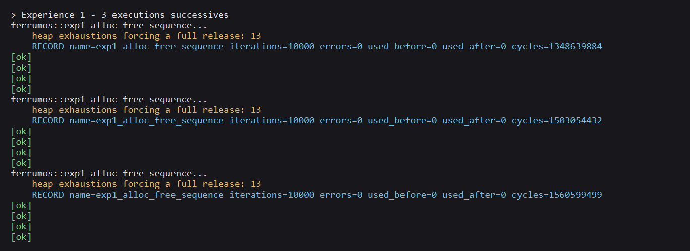
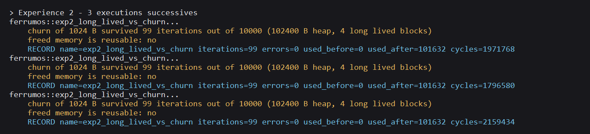
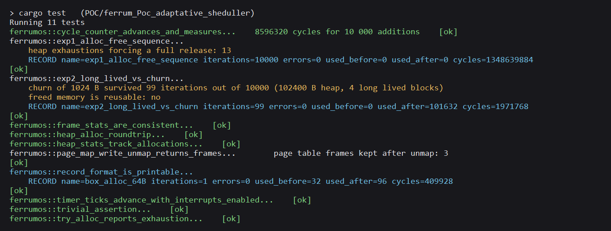

# Compte rendu des expériences 1 et 2 sur l'allocateur mémoire

> Mesures de référence (« avant ») de l'objectif **Mesurer et optimiser les performances mémoire**.
> Exécutées le 17 octobre 2026 sur `POC/ferrum_Poc_adaptative_sheduller`.
> Aucune optimisation n'a encore été appliquée : ce document établit le point de départ.

---

## 0. Synthèse : chaque test et son résultat

| Test | Ce qu'il vérifie | Résultat |
|---|---|---|
| **Expérience 1**, 10 000 allocations et libérations, tailles de 8 à 512 octets, alignements de 1 à 64 | Aucun chevauchement entre blocs vivants, contenu et alignements conservés | **Réussi.** 0 erreur aux trois exécutions. L'allocateur est correct. |
| **Expérience 2**, 4 blocs gardés vivants pendant qu'une boucle alloue et libère 1 Kio | La mémoire libérée reste réutilisable | **Échoué.** La boucle meurt à la 99e itération sur 10 000. Aucun octet libéré n'est réutilisé. |

**Le chiffre à retenir : 99.** C'est la mesure « avant » que les cycles
d'optimisation devront porter à 10 000.

Les tests de capacité du harnais, qui vérifient que les mesures elles-mêmes sont
fiables, passent également : compteurs mémoire, allocation faillible,
statistiques de cadres, chronomètre et format de relevé.

---

## 1. Ce que ces deux expériences doivent établir

| Expérience | Ce qu'elle doit vérifier |
|---|---|
| **1**, séquence fixe de 10 000 allocations et libérations, tailles et alignements variés | Aucun chevauchement entre blocs vivants ; contenu et alignements conservés |
| **2**, garder certaines allocations longtemps, créer et détruire les autres | La mémoire libérée reste réutilisable |

L'expérience 1 répond à la question « l'allocateur est-il **correct** ? ».
L'expérience 2 répond à la question « l'allocateur est-il **efficace** ? ».
Il faut répondre oui à la première avant d'avoir le droit d'optimiser la seconde.

---

## 2. Environnement de mesure

Les mesures ne sont comparables que dans cet environnement exact. Il est figé
dans `POC/ferrum_Poc_adaptative_sheduller/TEST_ENVIRONMENT.md`.

| Élément | Valeur |
|---|---|
| Rust | `nightly-2026-01-15` (rustc 1.94.0-nightly) |
| `bootimage` | 0.10.3 |
| `bootloader` | 0.9.34 |
| QEMU | 11.1.0, sans accélération matérielle |
| Tas | 100 Kio, à partir de `0x4444_4444_0000` |
| Allocateur | bump : le pointeur avance, et ne recule que si **toutes** les allocations sont libérées |
| Commande | `cargo test` |

Le protocole impose des mesures « à versions, configuration QEMU et charge
identiques ». C'est le cas ici : les trois exécutions ci-dessous proviennent de
la même commande, sur la même machine, sans rien d'autre en cours.

---

## 3. Expérience 1, séquence de 10 000 allocations et libérations

### 3.1 Protocole

- **10 000 itérations** pilotées par un générateur pseudo-aléatoire xorshift à **graine fixe** (`0x2026_1017`). La séquence est donc identique à chaque exécution.
- Tailles tirées entre **8 et 512 octets**, alignements tirés entre **1 et 64 octets**.
- Jusqu'à **32 blocs vivants** simultanément. À chaque itération, le tirage décide d'allouer ou de libérer un bloc existant.
- Chaque bloc est rempli d'un **motif** dépendant de son numéro d'itération.
- Trois vérifications à chaque opération :
  1. l'adresse retournée respecte l'alignement demandé ;
  2. le nouveau bloc ne **chevauche** aucun bloc vivant ;
  3. avant libération, le motif est **relu et comparé**.
- Toute violation incrémente un compteur d'erreurs. Le test échoue si ce compteur n'est pas nul.

### 3.2 Résultats



| Exécution | Itérations | Erreurs | Épuisements du tas | Cycles |
|---|---|---|---|---|
| 1 | 10 000 | **0** | 13 | 1 348 639 884 |
| 2 | 10 000 | **0** | 13 | 1 503 054 432 |
| 3 | 10 000 | **0** | 13 | 1 560 599 499 |

### 3.3 Interprétation

**L'allocateur est correct.** Sur 10 000 opérations, aucun chevauchement, aucun
motif corrompu, aucun alignement violé. Ce résultat est **identique aux trois
exécutions**, ce qui était attendu puisque la graine est fixe.

Mais la colonne « épuisements » révèle le problème. **Treize fois**, le tas de
100 Kio a été entièrement consommé alors qu'au plus 32 blocs de 512 octets
étaient vivants, soit **16 Kio au maximum**. À chaque épuisement, il a fallu
libérer *tous* les blocs vivants pour que l'allocateur reparte du début.

Autrement dit, les 10 000 opérations ont consommé environ **1,3 Mio** de tas
cumulé pour un besoin réel qui n'a jamais dépassé 16 Kio.

---

## 4. Expérience 2, allocations longues face à des allocations courtes

### 4.1 Protocole

- **4 blocs de 64 octets** alloués au début et **gardés vivants** jusqu'à la fin.
- Puis une boucle qui alloue **1 Kio**, écrit dedans, et le libère **immédiatement**. Un seul bloc d'1 Kio est donc vivant à la fois.
- Cible : **10 000 itérations**. La boucle s'arrête à la première allocation qui échoue.
- Les motifs des 4 blocs longue durée sont vérifiés à la fin.

Un allocateur qui récupère la mémoire libérée doit atteindre les 10 000
itérations sans difficulté : il réutilise sans cesse le même kilo-octet.

### 4.2 Résultats



| Exécution | Itérations tenues | Objectif | Erreurs | Mémoire utilisée en fin | Cycles |
|---|---|---|---|---|---|
| 1 | **99** | 10 000 | 0 | 101 632 o | 1 971 768 |
| 2 | **99** | 10 000 | 0 | 101 632 o | 1 796 580 |
| 3 | **99** | 10 000 | 0 | 101 632 o | 2 159 434 |

### 4.3 Interprétation

**La mémoire libérée n'est pas réutilisable.** La boucle meurt à la **99e
itération** sur 10 000, soit **1 % de l'objectif**.

Le calcul confirme la cause : 99 × 1 Kio ≈ 101 Kio, c'est-à-dire **exactement la
taille du tas**. Chaque libération n'a donc rien rendu du tout. Le pointeur de
l'allocateur avance à chaque allocation et ne recule jamais, parce que les
4 blocs longue durée empêchent le compteur d'allocations vivantes de retomber à
zéro.

Les 4 blocs longue durée, eux, sont **intacts** : la mémoire n'est pas corrompue,
elle est simplement gaspillée.

**C'est le verrou technique à lever.** Et le chiffre de référence est simple :

> **99 itérations.** Après optimisation, cette même boucle devra atteindre 10 000.

---

## 5. Les limites révélées par ces deux expériences

Cette section est le cœur du compte rendu. Elle distingue deux choses trop
souvent confondues : les limites **du noyau**, que les tests ont mises en
évidence, et les limites **des tests eux-mêmes**, c'est-à-dire tout ce qu'ils ne
prouvent pas.

### 5.1 Limites du noyau mises en évidence

#### Limite 1 : le taux de réutilisation de la mémoire est nul

L'expérience 2 le chiffre sans ambiguïté. Sur 99 libérations d'un bloc d'1 Kio,
**zéro octet** a été rendu au tas. Ce n'est pas un rendement faible, c'est un
rendement nul.

La conséquence se formule simplement : **la quantité totale de mémoire qu'un
programme peut allouer pendant toute sa vie est plafonnée à la taille du tas**,
indépendamment de ce qu'il libère. Avec 100 Kio de tas, un noyau qui alloue
1 Kio par seconde meurt en moins de deux minutes, même s'il ne garde jamais plus
de 2 Kio vivants.

#### Limite 2 : la remise à zéro est inutilisable en conditions réelles

L'allocateur ne récupère la mémoire que si le compteur d'allocations vivantes
retombe à **zéro**, c'est-à-dire si absolument tout est libéré au même instant.

L'expérience 1 a dû provoquer cette situation **13 fois** artificiellement, en
libérant tous ses blocs. Un vrai noyau ne peut pas faire cela : le shell garde
son tampon de saisie, l'ordonnanceur garde ses structures de tâches, les pilotes
gardent leurs files. **Il y aura toujours au moins une allocation vivante**, donc
la remise à zéro ne se produira jamais.

Les 13 épuisements ne sont donc pas une bonne nouvelle, ils sont la mesure de
l'artifice qu'il a fallu pour que le test survive.

#### Limite 3 : l'échec d'allocation reste fatal sur le chemin standard

`try_alloc` renvoie bien une erreur, et c'est ce qui a permis aux deux
expériences de se terminer proprement. Mais c'est une fonction ajoutée pour les
tests.

Le chemin normal de Rust, celui de `Box`, `Vec` ou `String`, passe par
l'allocateur global, qui renvoie un pointeur nul, ce qui déclenche une
**panique du noyau**. Autrement dit : **n'importe quelle allocation ordinaire
qui survient après l'épuisement du tas arrête le système**. Le noyau n'a aucune
stratégie de dégradation.

#### Limite 4 : la fragmentation n'est pas mesurable aujourd'hui

Le protocole demande de suivre la fragmentation. C'est impossible en l'état, et
pour une raison amusante : **un allocateur à pointeur qui avance ne fragmente
pas**, il gaspille. Il n'y a pas de trous entre les blocs, il n'y a qu'une zone
consommée et une zone vierge.

La fragmentation deviendra une grandeur mesurable seulement **après** le premier
cycle d'optimisation, quand une liste de blocs libres existera. Il faudra alors
ajouter la métrique, sans quoi on remplacera un problème mesuré par un problème
invisible.

#### Limite 5 : la mémoire réellement vivante n'est pas connue

Le compteur `used` de l'allocateur mesure **l'avancée du pointeur**, pas la somme
des blocs effectivement vivants. Dans l'expérience 2, il affiche 101 632 octets
en fin de test alors que **256 octets seulement** étaient réellement utilisés par
les 4 blocs longue durée.

Tant que cette distinction n'est pas instrumentée, aucune phrase du type « le
noyau consomme X octets » n'est défendable.

#### Limite 6 : le tas est fixe et minuscule

100 Kio sont câblés dans le code, sans possibilité d'agrandissement à chaud.
C'est une limite indépendante de l'allocateur : même parfait, il resterait
contraint par ce plafond. L'expérience 2 ne mesure donc pas seulement une
faiblesse de l'algorithme, elle mesure aussi un choix de dimensionnement.

#### Limite 7 : les cadres de tables de pages ne sont jamais rendus

Découverte en construisant le harnais, et confirmée par le test du cycle de
pages : le premier mappage d'une nouvelle plage d'adresses consomme **3 cadres**
de tables de pages qui ne reviennent jamais au démappage. C'est une fuite d'un
étage en dessous du tas, qui concernera l'expérience 4.

### 5.2 Limites des expériences elles-mêmes

Ce que ces deux tests **ne prouvent pas**, et qu'il serait malhonnête de
présenter comme acquis.

#### Limite A : rien n'est prouvé en situation de concurrence

Les deux expériences tournent **mono-tâche, interruptions du timer masquées**.
L'allocateur est pourtant protégé par un verrou tournant, donc conçu pour un
usage concurrent. Ce verrou n'a **jamais été éprouvé** : ni réentrance depuis un
gestionnaire d'interruption, ni course entre deux tâches.

C'est précisément l'objet de l'expérience 5, et la moitié « plusieurs tâches »
restera impossible tant que l'ordonnanceur ne fera pas de vrai changement de
contexte.

#### Limite B : une seule séquence a été testée

La graine est fixe, ce qui rend les résultats reproductibles. C'est voulu, mais
le revers est direct : **une séquence testée, ce n'est pas l'absence de bug**.
Les 10 000 opérations explorent un chemin parmi une infinité.

Un allocateur plus complexe, par exemple à liste chaînée, aura des cas limites
que cette séquence unique peut parfaitement manquer. Il faudra alors rejouer le
test avec plusieurs graines.

#### Limite C : les débordements d'un octet ne sont pas détectés

Le motif n'est vérifié **qu'à l'intérieur** de chaque bloc. Une écriture d'un
octet juste avant ou juste après un bloc ne serait pas vue, sauf si elle écrase
par chance le motif d'un voisin. Il manque des octets témoins de part et d'autre
de chaque allocation.

#### Limite D : le domaine couvert est étroit

| Paramètre | Testé | Non testé |
|---|---|---|
| Taille des blocs | 8 à 512 octets | au-delà de 512 octets, et notamment les blocs de plus d'une page |
| Alignement | 1 à 64 octets | 128 octets et au-delà |
| Blocs vivants | 32 au maximum | les milliers de blocs vivants |
| Durée | 10 000 opérations | la tenue sur des heures |

Les grandes allocations sont justement celles qui mettent une liste de blocs
libres en difficulté. Elles devront entrer dans le domaine testé au moment du
premier cycle d'optimisation.

#### Limite E : les durées ne permettent aucune conclusion fine

Le compteur de cycles est émulé par QEMU, sans accélération matérielle. L'écart
entre deux exécutions identiques atteint **15 %**.

En pratique : un gain de performance inférieur à 20 % **ne pourra pas être
affirmé** sur la seule base des cycles. Et aucune mesure de latence par
opération, ni de pire cas, n'est possible aujourd'hui.

#### Limite F : le scénario de l'expérience 1 masque la vraie capacité

Pour tenir 10 000 opérations sur un tas de 100 Kio, l'expérience 1 libère tout
dès qu'elle manque de place. Elle **contourne** donc la limite qu'elle rencontre.

Les 13 épuisements sont un artefact de ce choix : avec des blocs plus gros ou une
fenêtre de blocs vivants plus large, ce nombre changerait. Ce chiffre mesure le
scénario, pas le noyau. **Le seul chiffre qui mesure le noyau est celui de
l'expérience 2 : 99.**

### 5.3 Ce que ces limites imposent pour la suite

| Limite | Ce qu'elle impose avant ou pendant les cycles d'optimisation |
|---|---|
| Taux de réutilisation nul | C'est la cible : faire passer l'expérience 2 de 99 à 10 000 |
| Mémoire vivante inconnue | Ajouter un compteur de la somme des blocs vivants, distinct du pointeur |
| Fragmentation non mesurable | Ajouter la métrique en même temps que la liste de blocs libres |
| Échec fatal sur le chemin standard | Décider si le noyau doit survivre à un manque de mémoire, et le tester |
| Aucune preuve en concurrence | Expérience 5, puis vrai changement de contexte dans l'ordonnanceur |
| Une seule séquence | Rejouer avec plusieurs graines pour la non-régression |
| Durées peu fiables | Moyenner plusieurs exécutions, et s'appuyer d'abord sur les grandeurs déterministes |
| Domaine étroit | Étendre aux grands blocs et aux alignements élevés |

---

## 6. Fiabilité des mesures

| Grandeur | Reproductible ? | Commentaire |
|---|---|---|
| Nombre d'erreurs | **oui**, 0 aux trois exécutions | graine fixe |
| Épuisements du tas | **oui**, 13 aux trois exécutions | déterministe |
| Itérations tenues | **oui**, 99 aux trois exécutions | déterministe |
| Mémoire utilisée | **oui**, 101 632 o aux trois exécutions | déterministe |
| Cycles | **non**, écart d'environ 8 à 15 % | compteur émulé par QEMU |

---

## 7. Preuve d'exécution complète

La suite entière, 11 tests, telle qu'elle s'affiche en lançant `cargo test` :



La sortie brute des trois exécutions est conservée dans `logs/exp1-exp2-runs.log`.

> Les images ci-dessus sont le rendu fidèle de cette sortie console, mise en
> forme pour la lisibilité. Le fichier de log en est la source.

### Reproduire ces mesures

```
cd POC/ferrum_Poc_adaptative_sheduller
cargo test
```

---

## 8. Conclusion et suite

**Acquis :**

- l'allocateur est correct : 0 erreur sur 10 000 opérations ;
- sa limite est mesurée, chiffrée et reproductible : 99 itérations au lieu de 10 000 ;
- le protocole est rejouable par n'importe quel membre de l'équipe avec une seule commande.

**Prochaines étapes :**

| Étape | Contenu |
|---|---|
| Expérience 3 | Épuiser une réserve bornée, vérifier l'échec explicite et la reprise |
| Expérience 4 | Cycle allocation de page, mapping, écriture, démappage, libération |
| Expérience 5 | Rejouer le tout avec les interruptions actives |
| Cycle d'optimisation 1 | Une seule modification de l'allocateur, puis nouvelles mesures |
| Cycle d'optimisation 2 | Idem, en repartant des mesures du cycle 1 |

**Piste pour le premier cycle, à confirmer par la mesure :** remplacer
l'allocateur à pointeur par une liste chaînée de blocs libres. C'est la solution
la plus simple qui satisfait le critère « la mémoire libérée reste
réutilisable », ce qui rejoint le principe retenu dans le protocole :
privilégier la solution la plus simple qui satisfait les critères.

---

## Annexe : trouvailles annexes

Ces quatre défauts ont été découverts en construisant ces expériences. Ils ne
font pas partie du protocole, mais ils sont corrigés.

| Défaut | Conséquence | État |
|---|---|---|
| SSE2 activé dans la cible alors que le noyau n'active jamais SSE | Instruction invalide au démarrage, triple faute masquée par les redémarrages de QEMU | corrigé |
| Le lanceur de tests écrivait 33 au lieu de 0x10 sur le port de sortie | Tout test était compté comme un échec | corrigé |
| Écriture des masques du PIC sans désactiver les interruptions | Interblocage : le gestionnaire d'interruption tente de reprendre un verrou déjà tenu | corrigé |
| `allocations -= 1` sans protection | Débordement et panique du noyau en cas de libération en trop | corrigé |
